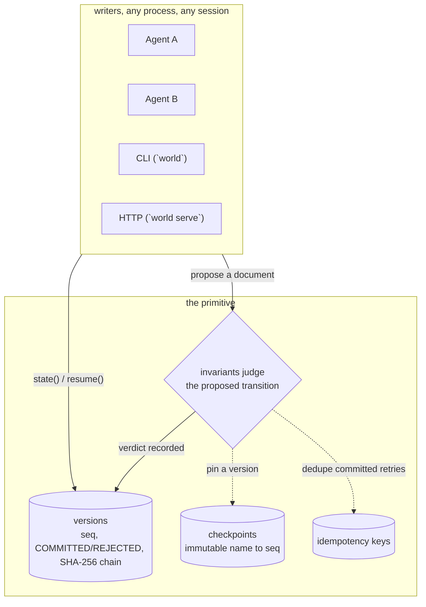

# WORLD: persistent work-state infrastructure for AI agents

**The problem.** AI agents do work that outlives any single session: a
research task, an investigation, a build. When that work passes to a
successor (a new session, a different model, a different tool), what
crosses the boundary is usually a natural-language summary or a raw
transcript. Summaries are lossy in exactly the places that matter:
decisions survive as prose if at all, and rationales, confidence
levels, supersession history, and binding constraints are the first
things compressed away. Transcripts preserve everything and index
nothing: the governance content sits inside chronological narrative,
and the successor must re-derive it, often renumbering it under its own
labels in the process. Neither format can be checked. Nothing verifies
that a constraint still holds, that a decision was superseded, or that
the record was not edited after the fact.

**What WORLD does differently.** WORLD is a named, durable document
that is the canonical state of a piece of work. Every proposed change
is judged by declared invariants before it is committed, and every
verdict, COMMITTED or REJECTED, is appended to a SHA-256 hash-chained
log, so rejected work is evidence rather than silence. The primitive
provides optimistic concurrency (`expected_version`), idempotent
retries, immutable checkpoints, deterministic replay, and
committed-only time travel. Agent A finishes; Agent B loads the state
by name and continues, with the decisions, assumptions, evidence,
constraints, and revision history intact and auditable.

**The research hypothesis** (stated as a hypothesis, not a result):
for work that moves between participants across sessions, explicit
structured work-state with stable labels preserves more
decision-relevant information across handoffs, and makes it more
auditable, than summaries or transcripts. Full statement, sub-claims,
and falsifiability conditions: `research/HYPOTHESIS.md`.

**What has actually been demonstrated.**

- In blind-graded handoff experiments (#001 Block; #002 Intel with a
  Disney replication; predeclared 14-metric answer keys, independent
  evaluator), the structured-state continuation preserved decision
  governance best in all three runs, narrowly. It also **failed
  revision history in both #002 runs**, and a strong summary came
  within 0.36 of it in the replication. n=1 per run, one model family:
  exploratory, not statistically significant.
- The commit protocol is model-checked exhaustively over bounded
  configurations: 1,220,255 explored states, properties P1 to P6
  holding throughout, with a mutation test proving the checker can
  fail (`docs/spec/protocol-verification.md`).
- A preregistered scripted-agent experiment lost updates in 33 of 50
  unprotected trials and 0 of 50 with `expected_version` plus retry
  (`experiments/lost-update/`).
- `verify()` detected 500 of 500 seeded random in-place mutations;
  crash injection recovered cleanly in 15 of 15 mid-transaction kills;
  a 1.06M-row soak showed no latency drift.

**What remains unproven.** Cross-model handoffs, human auditability in
practice, revision-history preservation (a current failure, not just
an untested area), and any real-world adoption: WORLD has no external
users and no deployments. Full list: `research/LIMITATIONS.md`.

[](https://github.com/RosarioM123/world-workstate-infrastructure/actions/workflows/ci.yml)


**Status:** v0.1.0 primitive. Working prototype, not deployed, not
production-ready. 377 tests in the suite (pytest; CI also runs
ruff and mypy on Python 3.11 to 3.13). Research documentation:
`research/RESEARCH_OVERVIEW.md`.

## Install

Not on PyPI yet. Install from source. The core has zero dependencies
(stdlib only).

```bash
git clone https://github.com/RosarioM123/world-workstate-infrastructure.git
cd world-workstate-infrastructure
python -m venv .venv && source .venv/bin/activate   # Windows: .venv\Scripts\activate
pip install -e .            # the `world` primitive + `world` CLI
pip install -e ".[server]"  # optional: `world serve` HTTP API
pip install -e ".[test]"    # optional: full test suite (server + property tests)

python examples/quickstart.py   # minimal example, self-contained
python -m pytest tests/ -q      # without the extras, server tests skip cleanly
world --help
```

## Quickstart

Ten lines, under five minutes. Zero dependencies, stdlib only.

```bash
pip install -e .   # add [server] for HTTP, [test] for the suite
```

```python
from world import World

work = World("my-project")                    # create (or load, same call)
work.update({"task": "draft memo", "done": False})
work.checkpoint("end-of-day")                 # pin this version
print(work.state())                           # {'task': 'draft memo', 'done': False}
print(work.verify())                          # True, hash chain intact
```

## The handoff

The scenario WORLD exists for. Two processes, as separate as two agents
can be: no shared memory, no shared session.

**Agent A** works, records, checkpoints. Its process then exits:

```python
from world import World, InvariantViolation
from world.invariants import no_negative

work = World("research-acme", invariants=[no_negative("budget")])
work.update({
    "decision": "source 18A yield data from SEC filings only",
    "assumptions": ["yields stabilize by Q3"],
    "open_questions": ["foundry breakeven date?"],
    "budget": 4000,
}, actor="agent-a", note="phase 1 findings")

try:
    work.update({"budget": -500}, actor="agent-a")   # judged
except InvariantViolation as e:
    print(e.seq, e.reason)                           # 2  no_negative: budget = -500
work.state()["budget"]                               # 4000, untouched

work.checkpoint("phase-1-done")
# Agent A's process exits here. Nothing else persists.
```

**Agent B** starts later, new interpreter, new session, and continues:

```python
from world import World

work = World("research-acme")          # loads A's state from disk
print(work.version)                    # 1, the work so far, numbered
print(work.state()["decision"])        # source 18A yield data from SEC filings only

state = work.state()
state["status"] = "phase 2 started"
work.update(state, actor="agent-b", note="picking up phase 2")

for h in work.history():               # the verdict log, how we got here
    print(h["seq"], h["status"], h["actor"], "-", h["note"])
# 1 COMMITTED agent-a - phase 1 findings
# 2 REJECTED agent-a - REJECTED: no_negative: budget = -500
# 3 COMMITTED agent-b - picking up phase 2
```

One honest detail: invariants are code, declared per handle. Agent B
judges with its own rules (or none). If every remote writer must face
the same rules, run `world serve`: the server declares invariants once
and judges all writers equally.

## Architecture



One named world is one SQLite file (`~/.world/<name>.db`, or
`$WORLD_DIR`). Handles are stateless views: every read hits the
database, so two processes sharing a name always agree. No cache to go
stale, no refresh API. Optional layers on the same log: signed tips
(HMAC or Ed25519, with key rotation), per-field encryption with
cryptographic redaction, and Merkle inclusion proofs for selective
disclosure. Design rationale: `docs/adr/0008-world-primitive.md`.

## State model

- **The document is opaque JSON.** `update()` replaces it wholesale: no
  merging, no schema, no migration. What you put in is what comes out.
- **Every proposal gets a verdict.** `COMMITTED` rows advance the state;
  `REJECTED` rows preserve the attempted document as evidence. Both are
  appended to a SHA-256 hash chain over prev-hash, seq, timestamp,
  actor, note, status, and the canonical state.
- **Checkpoints are immutable pins** (name to seq). `resume()` restores
  a checkpoint's document as a *new* version: history is append-only
  and is never rewritten.
- **Concurrency:** writers serialize on SQLite's write lock;
  `expected_version` gives optimistic concurrency (`ConflictError` on a
  stale read); `idempotency_key` makes retries safe: committed updates
  dedupe, rejections are always recorded.
- **Locks are a document convention,** not an engine feature: a `_locks`
  list of path patterns inside the document, enforced by the
  `respect_locks` invariant. Locking and unlocking are ordinary
  versioned updates, so every lock change is audited.
- **NaN, infinities, and non-JSON values are rejected** before anything
  is persisted.

### Correctness contract

The state model above is a contract the test suite enforces, not just
documentation:

- **Exactly-once proposal semantics.** Each proposal is judged, then
  appended exactly once. Writers serialize on SQLite's write lock;
  `expected_version` gives optimistic concurrency (`ConflictError` on a
  stale read) and `idempotency_key` dedupes committed retries while
  rejections are always recorded.
- **The invariant engine is the correctness boundary.** Nothing is
  persisted until the declared invariants pass. NaN, infinities, and
  non-JSON values are rejected before anything is written.
- **Tamper-evident audit trail.** Every version is SHA-256 hash-chained
  over prev-hash, seq, timestamp, actor, note, status, and the canonical
  state. `verify()` pinpoints the first bad row, and rejected proposals
  are chained too, so the trail records what was blocked and why.
- **Deterministic replay.** State rebuilds from the version log alone;
  checkpoints restore as new versions, never rewrites. Any participant
  replaying history arrives at the same state.

Boundary, stated plainly: tamper-evident, not immutable, and the
database cannot name the rule set that judged a historical version (see
Current limitations). The 377-test suite exercises each guarantee
above, and the commit protocol behind them is model-checked separately
(`docs/spec/protocol-verification.md`).

## API

Core operations. Full reference: `src/world/core.py` (typed, `py.typed`
shipped). Design rationale: `docs/adr/0008-world-primitive.md`.

| Operation  | Python                                                        | CLI                                       |
|------------|---------------------------------------------------------------|-------------------------------------------|
| create     | `World("my-project")`                                         | `world init my-project`                   |
| update     | `work.update(doc, actor=, note=, expected_version=, idempotency_key=)` returns seq | `world update my-project --file s.json` |
| batch update | `work.update_many(docs)` returns seqs, one transaction, same log as sequential calls | `world update-many my-project --file s.json` |
| checkpoint | `work.checkpoint("v1")` returns seq                                 | `world checkpoint my-project v1`          |
| load       | `work.state()` / `state(version=)` / `state(checkpoint=)` (committed versions only) | `world state my-project`                  |
| read       | `work.read()` returns `(state, version)` atomically | `world read my-project` |
| resume     | `work.resume("v1")` returns seq                                     | `world resume my-project v1`              |
| blame      | `work.blame("budget.total", version=)` returns row that last changed the field (committed only) | `world blame my-project budget.total` |
| selective disclosure | `work.merkle_root()`, `work.inclusion_proof(seq)`, `World.verify_inclusion(proof)` (DB-free) | (no CLI) |

Reads: `history(limit=)` (verdict log, oldest first), `proposal(seq)`
(audit one proposal by seq, any status), `verify()`
(hash-chain check), `version`, `checkpoints()`, `name`, `path`.
Optional integrity and confidentiality layers: `sign_tip` /
`verify_tip` (HMAC), `sign_tip_ed25519` / `verify_tip_ed25519` and
`rotate_ed25519` (Ed25519, vendored pure Python), `encrypt_fields` /
`decrypt_fields` / `redact` (per-field encryption and crypto-shredding
redaction; `src/world/fieldcrypto.py`).
Errors: `InvariantViolation` (carries `seq` and `reason` of the recorded
rejection), `ConflictError`, `KeyError` (unknown version/checkpoint),
`ValueError` (bad name, bad JSON, duplicate checkpoint).

### Invariants

An invariant is `(old_state, new_state) -> None`; raise
`InvariantViolation` to reject. Shipped helpers in `world.invariants`:
`no_negative(*paths)`, `finite_numbers(*paths)`, `require_keys(*paths)`,
`respect_locks()`, `monotonic(*paths, strict=False)`,
`immutable_fields(*paths)`, `type_stable(*paths)`, plus the `all_of(*invs)`
conjunction combinator (same verdict as listing them, but reports every
violated reason instead of short-circuiting on the first). Path patterns are
dot-separated with `*` wildcards (`"totals.*"`, `"tasks.0.status"`).
Anything else is a plain function you write. Non-violation exceptions
propagate uncaught and are *not* recorded: a crashing judge is a bug,
not a verdict.

### Performance

Measured 2026-10-15 with `python tools/bench_world.py` (10,000
versions, Linux x86_64, Python 3.12.3); full tables in
`docs/benchmarks/world-primitive.md`:

| operation | throughput |
|---|---:|
| `update` (invariant judged) | 1,339 ops/s |
| `update` (`expected_version`) | 692 ops/s |
| `state()` reads | 3,794 ops/s |
| `verify()` full chain | 200,081 rows/s |
| `update_many` (batches of 500) | 54,975 ops/s |

Every sequential write opens a fresh connection, judges invariants,
hashes the row, and commits inside `BEGIN IMMEDIATE`. No caching:
handles are stateless by design. Under concurrent writers, throughput
plateaus near 810 ops/s past 8 threads and the p99 tail degrades
sharply, while correctness holds (`docs/benchmarks/contention.md`).
Timings are machine-dependent historical records, not guarantees;
re-run before quoting.

### Agent handoff

The first agent-facing API on the primitive: no LLM provider dependency,
stdlib only. An agent writes its work state; a fresh agent recovers it
from the world name alone:

```python
from world import AgentState, Decision, Evidence, load_state, save_state

state = AgentState(
    objective="Draft the Q3 foundry memo",
    decisions=[Decision("Source yields from SEC filings only",
                        rationale="Filings give quarterly granularity")],
    evidence=[Evidence("Defect density improved 2x QoQ",
                       source="10-Q Q2 2026")],
    open_questions=["Foundry breakeven date?"],
    next_actions=["Build the DCF", "Run the credit stress case"],
)
save_state("research-acme", state, actor="agent-a")  # returns version seq

# later, a fresh session / process / model:
recovered = load_state("research-acme")   # the identical AgentState
```

`save_state` stores under the reserved `"handoff"` key (other document
keys are preserved); every save is a judged, hash-chained version.
`load_state` accepts a world name or a `World`, plus `version=` /
`checkpoint=` for historical handoffs, and raises `KeyError` if nothing
was ever saved. Round-trip fidelity is pinned by `tests/test_handoff.py`,
including a two-interpreter test proving no in-memory state leaks.

### CLI and HTTP

The `world` command covers every operation: `init`, `update`,
`update-many`, `state`, `read`, `checkpoint`, `checkpoints`, `resume`,
`history`, `proposal`, `verify`, `diff`, `blame`, `export`, `import`,
`import-transcript`, `serve`. `world serve my-project` (needs
`pip install -e ".[server]"`) exposes the same model over HTTP
(`GET /v1/state`, `POST /v1/update`, `/v1/checkpoint`, `/v1/resume`,
`GET /v1/history`, `/v1/checkpoints`, `/v1/verify`) with an API-key gate
(`WORLD_API_KEY` maps to the `X-API-Key` header; fail-open with a warning
when unset) and per-IP write rate limiting. Declare invariants once via
`--invariants mymod:rules`. `world import-transcript` folds a chat
transcript into `state["transcript"]`, idempotent on the transcript text.

## Research

The thesis is tested, not asserted. Research home: `research/`
(overview, hypothesis, limitations, related work). Both handoff
experiments hand the same Agent A research output to a successor Agent
B in three conditions (structured WORLD state, conventional summary,
raw transcript/journal) and blind-grade the continuations.

Method detail (#002): conditions are blind-labeled X/Y/Z with filename
and format echoes stripped, graded by an independent evaluator against
a predeclared 14-metric answer key built from Agent A's decisions and
assumptions before grading; the mapping is revealed only after scoring.
The full design replicates on a second domain (Disney after Intel).

- **#001** (2026-09-17, Block Inc.): WORLD state won on governance:
  5/5 decisions with rationales intact, 7/7 assumptions with confidence
  levels, zero errors. Narrative formats preserved facts but lost
  decisions-as-decisions. n=1. (`docs/experiment-001-results.md`)
- **#002** (2026-09-17 to 23, Intel plus Disney replication):
  WORLD-state continuation preserved decision governance best in both
  runs (Intel 3.92 vs 3.58 vs 3.33; Disney 4.45 vs 4.09 vs 2.82,
  reference means), but the advantage is narrow, the summary came
  within 0.36 in the replication, and the WORLD continuation failed on
  revision history in both runs. Thesis partially supported, narrowly
  scoped. (`docs/experiment-002/results.md`)

Verification work behind the primitive (all with artifacts in the
repo): protocol model checking (1,220,255 states, P1 to P6,
`docs/spec/protocol-verification.md`); Hypothesis stateful testing
against a reference model (`docs/spec/stateful-testing.md`);
linearizability checking (`docs/spec/linearizability.md`);
deterministic simulation (`docs/spec/deterministic-simulation.md`);
verifier fuzzing and a red-team suite with tested limits
(`docs/SECURITY.md`); crash-consistency fault injection, 15 of 15
mid-transaction kills recovered (`experiments/crash-consistency/`);
a 1.06M-row soak (`experiments/soak/`); and an independent C# chain
verifier sharing no code with the Python implementation
(`tools/ChainVerifyWorld/`).

Standing rule: report the ugly number. A stated weakness with a results
file behind it beats a suspiciously perfect run with none.

### Reproduction

```bash
pip install -e ".[test]"
python -m pytest tests/ -q                       # full suite
python3 spec/model_check.py                      # model checker + mutation test
python tools/bench_world.py                      # primitive benchmarks
python tools/bench_contention.py                 # contention profile
```

Experiment protocols were predeclared (`docs/experiment-002/protocol.md`,
`experiments/lost-update/PREREGISTRATION.md`); raw outputs, answer keys,
and grading records are kept in `docs/experiment-002/` and
`experiments/`.

## Current limitations

- **Tamper-evident, not immutable.** The hash chain detects edits;
  anyone holding the DB file can rewrite the whole chain consistently.
  Optional signed tips anchor the tip only if a verifier holds key
  material out of band. No consensus, no third-party witnessing.
  `docs/SECURITY.md` lists which attacks are and are not detected,
  including tested undetected cases.
- **Invariants are code, not data.** The database cannot name the rule
  set that judged a historical version. Two handles on one world can
  judge by different rules; `world serve` is the uniform-enforcement
  point for remote writers.
- **No per-actor identity.** `actor` is self-asserted. The API-key gate
  authenticates the deployment, not the writer. No RBAC.
- **Single-writer serialization.** Appends serialize on SQLite's write
  lock by design; `expected_version` is optimistic concurrency, not a
  transaction across documents. Tail latency degrades sharply under
  many concurrent writers (see Performance).
- **`verify()` is O(n) in time and memory.** A 1.06M-row chain verified
  in 14.0s at 659 MB RSS in the soak test. A streaming verifier is
  future work.
- **Local-first.** One SQLite file per world. No replication, no sync
  protocol: multi-machine sharing is out of scope for the primitive.
- **No external validation yet.** No deployments, no external users,
  and the handoff evidence is n=1 per run on one model family. See
  `research/LIMITATIONS.md` for the complete list, including the
  revision-history failure.

## Roadmap

- Persisted invariant registry: the DB names the rules that judged
  each version (closes the code-not-data gap)
- Streaming `verify()` (constant memory)
- Retire or merge the legacy `world_engine` package (below)
- Experiment #003: adversarial handoff, conflicting successor goals,
  testing whether governance survives disagreement, not just amnesia;
  plus a targeted revision-history experiment, the open failure from
  #002
- Sync protocol design: only if #003 and real adoption demand it;
  explicitly not started

## Legacy: the `world_engine` demo

The repo also contains the original prototype this primitive was
distilled from: a deterministic constraint-checked ledger for a
synthetic logistics domain, with a FastAPI backend, a React landing
page, an offline client SDK (`src/world_sdk`, `docs/SDK.md`), and a
deterministic transcript importer. It is **not** the product direction;
the `world` primitive above is. Its hardening work (hash-chained
verdicts, atomic writes, idempotency, replay, locks, API-key gate, rate
limiting) is what the primitive was built from.

Pointers: `src/world_engine/` (kernel), `src/world_sdk/`,
`examples/synthetic-logistics-demo/`, `tools/bench.py`, `docs/adr/`.
The primitive's own design rationale is
`docs/adr/0008-world-primitive.md`.

## Repository layout

```
/src/world            the primitive (this README): core, invariants,
                      CLI, HTTP server (opt-in), handoff layer,
                      signing, field crypto, transcript producer
/src/world_engine     legacy demo kernel (see above)
/src/world_sdk        legacy offline client SDK (docs/SDK.md)
/tests                377 tests: primitive, kernel, SDK, API, security
/spec                 protocol model checker, TLA+ transcription,
                      linearizability and deterministic-simulation checkers
/research             research overview, hypothesis, limitations, related work
/docs/adr             architecture decision records
/docs                 thesis, hypothesis, state model, experiments, specs
/experiments          handoff and systems experiment harnesses + results
```

## Rules

- No secrets in this repo: no API keys, passwords, tokens, or `.env` files.
- This repo is the single home of the WORLD project. No new repos for it.
