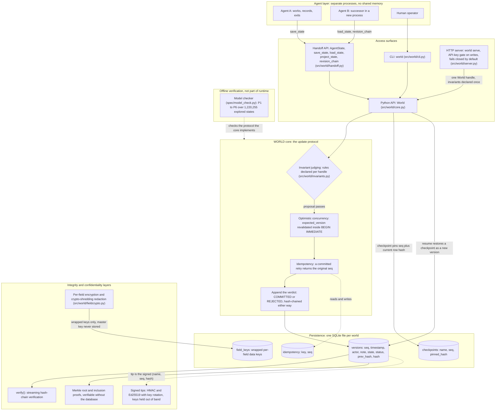

# WORLD architecture

This document describes the architecture as implemented in
`src/world/` at version 0.1.0 plus the uncommitted Prompt 3 changes.
Every component named here exists in the code; the legacy
`world_engine` package is a separate frozen prototype and is not
part of this diagram. The editable diagram source is
`docs/architecture.mmd`; the rendered form is embedded below.

## Component inventory

| Component | Code | What it does |
|---|---|---|
| `World` | `src/world/core.py` | The primitive: a named JSON document, judged updates, hash-chained verdict log, checkpoints, time travel, signing, Merkle proofs |
| Invariants | `src/world/invariants.py` | Callable rules `(old_state, new_state)` that reject a proposal by raising `InvariantViolation`; shipped helpers include `no_negative`, `monotonic`, `immutable_fields`, `type_stable`, `finite_numbers`, `require_keys`, `respect_locks`, `all_of` |
| Handoff API | `src/world/handoff.py` | Typed `AgentState` (objective, decisions, assumptions, evidence, open questions, next actions) stored under the reserved `handoff` document key; `save_state` validates the revision graph, `revision_chain` derives one decision's history from committed snapshots, `project_state` renders a compact reading view |
| CLI | `src/world/cli.py` | The `world` command: init, update, state, checkpoint, resume, history, proposal, verify, diff, blame, export, import, serve |
| HTTP server | `src/world/server.py` | Optional FastAPI surface (`pip install -e ".[server]"`); one handle with invariants declared once; write routes gated by an API key and fail closed when no key is configured unless `--allow-unauthenticated` is explicit |
| Field crypto | `src/world/fieldcrypto.py` | Per-field authenticated encryption (custom HMAC-CTR, encrypt-then-MAC) and redaction by crypto-shredding the wrapped field key |
| Ed25519 | `src/world/ed25519.py` | Vendored pure-Python Ed25519 for signed tips and rotation certificates; RFC 8032 validated; not constant-time |
| Model checker | `spec/model_check.py` | Explicit-state checker for the commit protocol; not a runtime component |

## Data flow

**Write path.** A writer proposes a whole document through any
surface. The handle's invariants judge the transition against the
current committed state (fast path). Inside a `BEGIN IMMEDIATE`
transaction the expected version is revalidated, so the judgment
and the append are atomic; a committed `idempotency_key` returns
the original seq instead of appending. The verdict, COMMITTED or
REJECTED, is appended to `versions` with the SHA-256 hash of the
previous row's hash and this row's fields. A rejected proposal
changes no state and is preserved as evidence.

**Read and resume path.** Handles are stateless: every read hits
SQLite, so two processes sharing a world name agree. `state()`
returns the latest committed document, `state(version=N)` any
committed snapshot (full snapshots are stored per row, so this is
retrieval, not replay), and `resume(name)` appends a checkpoint's
document as a new version judged by current invariants. History is
never rewritten. `revision_chain` walks committed snapshots and
extracts one decision's entries where its text, status, rationale,
supersession, or evidence links changed.

**Verification path.** `verify()` streams the `versions` table and
recomputes every hash link (Prompt 3 F5: constant memory in chain
length). Checkpoint reads verify the pinned row hash stored at
checkpoint time (F3a). Signed tips move the trust anchor out of the
database: a holder who stored a signed `(name, seq, hash)` tip can
detect rollback and full rewrite, which `verify()` alone cannot.

## Trust boundaries

- **Writers to core.** There is no per-actor authentication in the
  core. The `actor` string is self-asserted; the hash chain makes
  it tamper-evident after the fact, not authenticated at write
  time. The HTTP server's API key authenticates the deployment,
  not the individual writer; an optional server-side actor override
  (F4) pins one actor label for single-purpose deployments.
- **Core to database file.** Anyone who can read the file sees
  every document not explicitly field-encrypted, including
  rejected proposals. Anyone who can write the file can recompute
  a fully consistent forged chain: the row hash is unkeyed, so the
  chain is tamper-evident against partial edits, not immutable and
  not authentic on its own. `docs/SECURITY.md` lists the detected
  and undetected attack classes, each pinned by a test.
- **Key material.** Signing keys and the field-encryption master
  key are supplied by callers and never written to the database.
  Only wrapped per-field keys (`field_keys`) and signatures'
  outputs touch disk.
- **Judging boundary.** Invariants live on the handle, not in the
  database, so the record cannot name the rule set that judged a
  historical version, and two handles can judge differently. The
  HTTP server is the uniform-enforcement point for remote writers
  because it declares invariants once for all of them.

## Deliberate omissions

Deterministic replay is not a component of the primitive: full
snapshots make it unnecessary (`replay_ledger()` exists only in
the legacy `world_engine`). There is no replication, sync, or
consensus component; one world is one local SQLite file. No
component in this diagram performs LLM calls; WORLD stores and
verifies state, it does not generate it.
